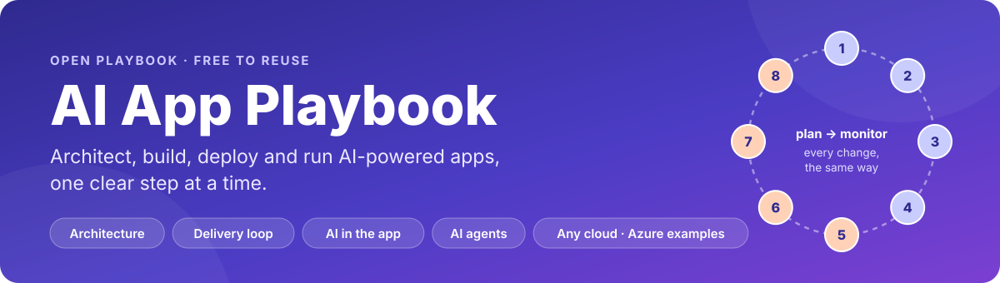
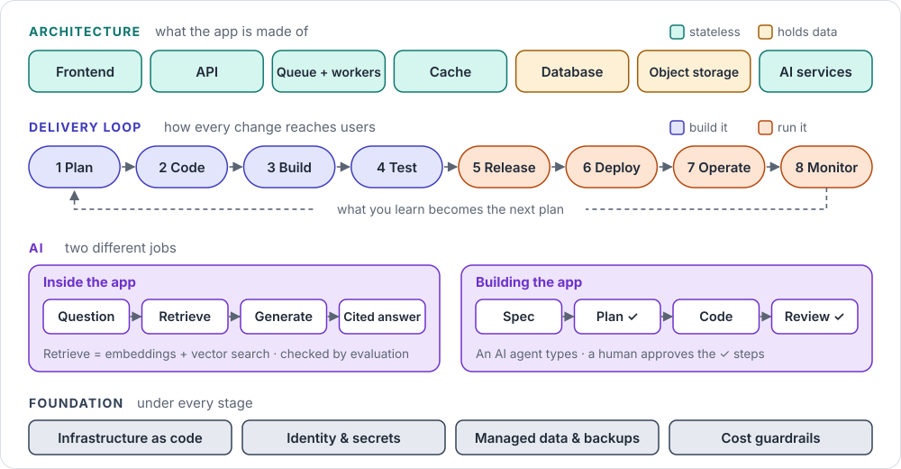
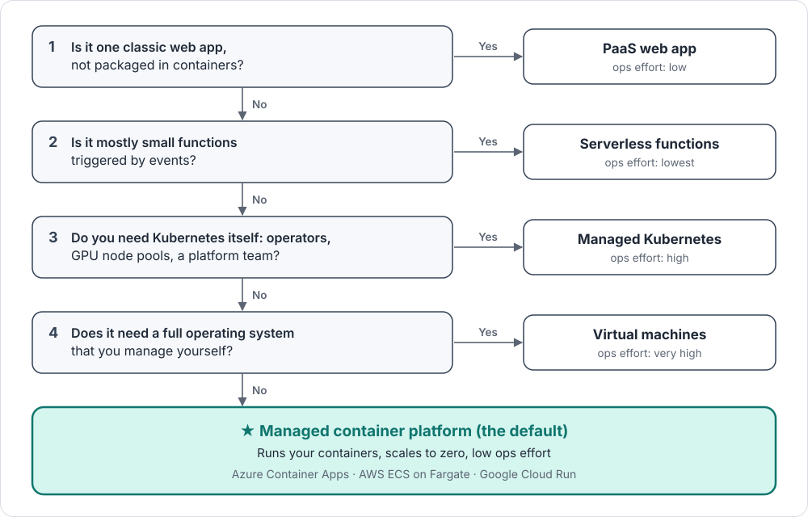
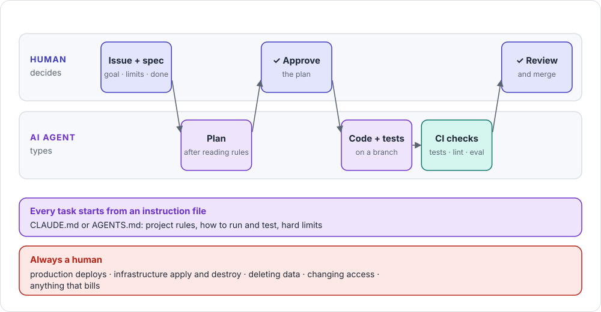
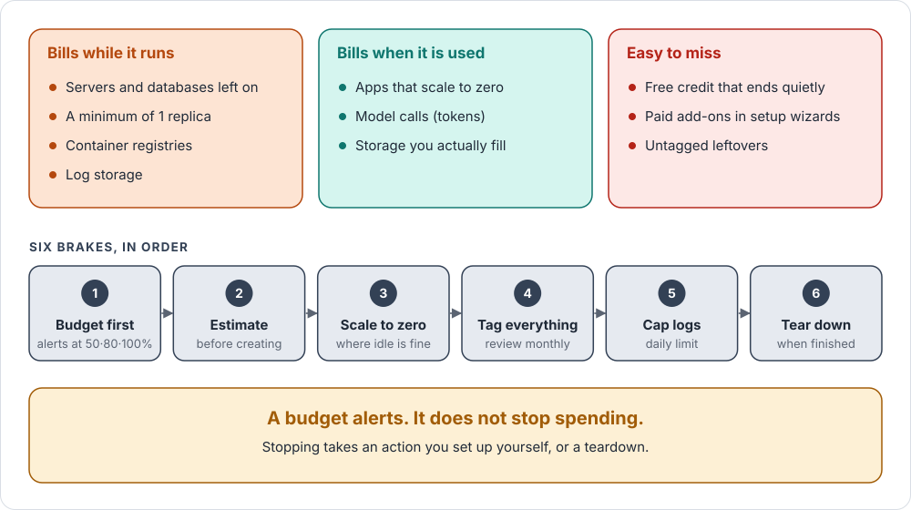

<p align="center">
  <a href="https://lounissi1.github.io/ai-app-playbook/">
    
  </a>
</p>

<p align="center">
  <a href="https://lounissi1.github.io/ai-app-playbook/"></a>
  <a href="https://lounissi1.github.io/ai-app-playbook/memos/"></a>
  <a href="https://github.com/lounissi1/ai-app-playbook/generate"></a>
</p>

<p align="center">
  <a href="https://github.com/lounissi1/ai-app-playbook/actions/workflows/docs.yml"></a>
  <a href="LICENSE"></a>
  <a href="LICENSE-CODE"></a>
  
</p>

**A golden path for AI-powered apps.** One documented, repeatable way to take an application from
first sketch to production and keep it running: the architecture it should have, the AI
components it may need, and the delivery loop that ships it. Start with a picture, go deeper only
when you build.

## The playbook in one picture

<p align="center">
  <a href="https://lounissi1.github.io/ai-app-playbook/memos/playbook/">
    
  </a>
</p>

## Eight one-minute memos

One topic, one picture, five things to remember. Click any picture to open the memo.

<table>
  <tr>
    <td width="50%" valign="top">
      <a href="https://lounissi1.github.io/ai-app-playbook/memos/architecture/"></a>
      <br><b>🧱 App architecture</b><br>Seven parts, and only two of them hold data.
    </td>
    <td width="50%" valign="top">
      <a href="https://lounissi1.github.io/ai-app-playbook/memos/delivery-loop/"></a>
      <br><b>🔄 The delivery loop</b><br>Eight steps every change takes, from idea to production and back.
    </td>
  </tr>
  <tr>
    <td width="50%" valign="top">
      <a href="https://lounissi1.github.io/ai-app-playbook/memos/hosting/"></a>
      <br><b>🖥️ Where does my code run?</b><br>Four questions pick the hosting. Most apps end at the default.
    </td>
    <td width="50%" valign="top">
      <a href="https://lounissi1.github.io/ai-app-playbook/memos/ai-in-app/"></a>
      <br><b>🧠 AI inside the app</b><br>Answer questions from your own documents, with sources.
    </td>
  </tr>
  <tr>
    <td width="50%" valign="top">
      <a href="https://lounissi1.github.io/ai-app-playbook/memos/ai-agents/"></a>
      <br><b>🤖 Building with AI agents</b><br>The agent types; you approve the plan and the merge.
    </td>
    <td width="50%" valign="top">
      <a href="https://lounissi1.github.io/ai-app-playbook/memos/going-live/"></a>
      <br><b>🚀 Going live</b><br>The minimum checks before real users depend on the app.
    </td>
  </tr>
  <tr>
    <td width="50%" valign="top">
      <a href="https://lounissi1.github.io/ai-app-playbook/memos/cost/"></a>
      <br><b>💰 Cost guardrails</b><br>What bills, what's easy to miss, and six brakes.
    </td>
    <td width="50%" valign="top">
      <a href="https://lounissi1.github.io/ai-app-playbook/memos/playbook/"></a>
      <br><b>🗺️ The playbook in one picture</b><br>Everything above, on one page.
    </td>
  </tr>
</table>

## Who it's for

| If you are… | Start with |
|---|---|
| 🎓 **Learning** cloud, DevOps or AI engineering | The [memos](https://lounissi1.github.io/ai-app-playbook/memos/), then the [cheat sheet](docs/cheatsheet.md) |
| 🛠️ **Building** an app and want a safe default for every choice | **Use this template**, then the [new app checklist](docs/checklists/new-app.md) |
| 🤖 **Working with AI coding agents** | [CLAUDE.md](CLAUDE.md) and [Working with AI agents](docs/guides/ai-agents.md) |
| 📚 **Looking up one concept** | The [cards](docs/cards/index.md): one idea per page, each ending with a two-line summary |

## Four questions that sort every tool

| Question | Default answer here | Alternatives |
|---|---|---|
| What are the parts of my app? | The [reference architecture](docs/cards/reference-architecture.md) | Split further only with a [reason](docs/decisions/when-to-split.md) |
| Where does my code run? | Managed container platform (Azure Container Apps) | VMs, App Service, Kubernetes / AKS, Functions |
| How are the cloud resources created? | Terraform | Bicep, OpenTofu, Pulumi, portal clicks |
| How does new code get there? | GitHub Actions | Azure DevOps Pipelines, GitLab CI, Jenkins |

## What's inside

| Layer | For | Where |
|---|---|---|
| **Memos** | People: the picture in a minute | [docs/memos/](docs/memos/) |
| **Cheat sheet** | The whole subject on one page | [docs/cheatsheet.md](docs/cheatsheet.md) |
| **Guides** | Each stage step by step, plus architecture, security, infrastructure, cost, AI agents | [docs/guides/](docs/guides/) |
| **Cards** | One concept each, mapped to Azure, AWS, Google Cloud and open source | [docs/cards/](docs/cards/) |
| **Decisions** | Choosing between options | [docs/decisions/](docs/decisions/) |
| **Checklists** | Gates: new app, production ready, teardown | [docs/checklists/](docs/checklists/) |
| **Starters** | Real, copyable files (Azure first) | [starters/](starters/) |
| **Templates** | Write a new page in the house style | [templates/](templates/) · [CONTRIBUTING.md](CONTRIBUTING.md) |

Every page is one of six document types with a fixed structure, so humans and AI agents always know
where to find things. See [CONTRIBUTING.md](CONTRIBUTING.md).

> **Status:** early draft. Pages move from *draft* to *reviewed* once they're used on a real project.
> Progress is tracked in [DONE.md](DONE.md).

## Start a new app from this template

1. Click **Use this template** to create your app's repository.
2. Design it with [the architecture guide](docs/guides/architecture.md).
3. Follow [the new app checklist](docs/checklists/new-app.md) from top to bottom.
4. Copy what you need from `starters/azure/`.
5. Before going live, pass [the production-ready checklist](docs/checklists/production-ready.md).
6. When you're done experimenting, follow [the teardown checklist](docs/checklists/teardown.md).

## Read it as a website

**Online:** https://lounissi1.github.io/ai-app-playbook/ (published automatically from `main`).

To preview locally, the docs build with [MkDocs Material](https://squidfunk.github.io/mkdocs-material/):

```bash
pip install -r requirements-docs.txt
mkdocs serve        # open http://127.0.0.1:8000
```

The infographics are generated from data by `python tools/make_memo_svgs.py`.

## Scope

This repository covers **how an AI-powered app is designed, built, shipped and run**. Deeper
handbooks (data science, agentic AI, remote sensing, precision agriculture, mathematics) are
parked in [IDEAS.md](IDEAS.md) and will live in separate repositories that reuse the same schemas.

## Author

Created and maintained by **Lamjed Lounissi** ([@lounissi1](https://github.com/lounissi1)),
drawing on experience in data science, satellite data and GIS, and scientific software.
Suggestions and corrections are welcome: open an issue or a pull request.

⭐ If this helps you, **star the repository** so others can find it too.

To cite this playbook, use **Cite this repository** on GitHub (from [CITATION.cff](CITATION.cff)).

## License

Documentation: [CC BY 4.0](https://creativecommons.org/licenses/by/4.0/). Reuse it freely with credit.
Code in `starters/` and workflows: [MIT](LICENSE-CODE). Details in [LICENSE](LICENSE).
