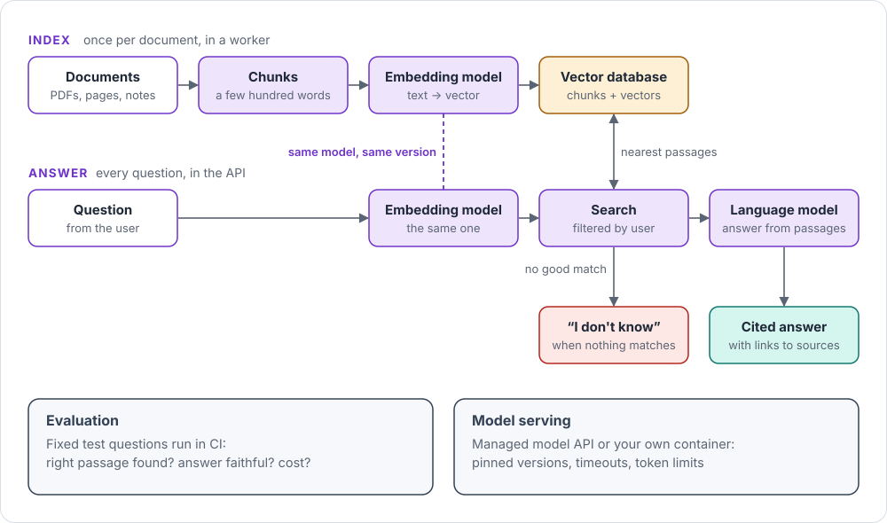

# AI inside the app

How an app answers questions from its own documents: retrieval-augmented generation (RAG).

## In one picture

## Remember

- **Index once, answer many times:** documents are embedded in a worker, questions in the API.
- **Same embedding model, same version, everywhere.** Otherwise search returns noise.
- **Filter by user at search time,** so nobody sees documents that aren't theirs.
- **No good match? Say “I don't know”** instead of guessing.
- **Measure it:** a fixed set of test questions runs in CI on every change.

## Go deeper

- [Retrieval-augmented generation](../cards/rag.md) · [Embeddings and vector search](../cards/embeddings-vector-search.md)
- [Model serving](../cards/model-serving.md) · [AI evaluation](../cards/ai-evaluation.md)
