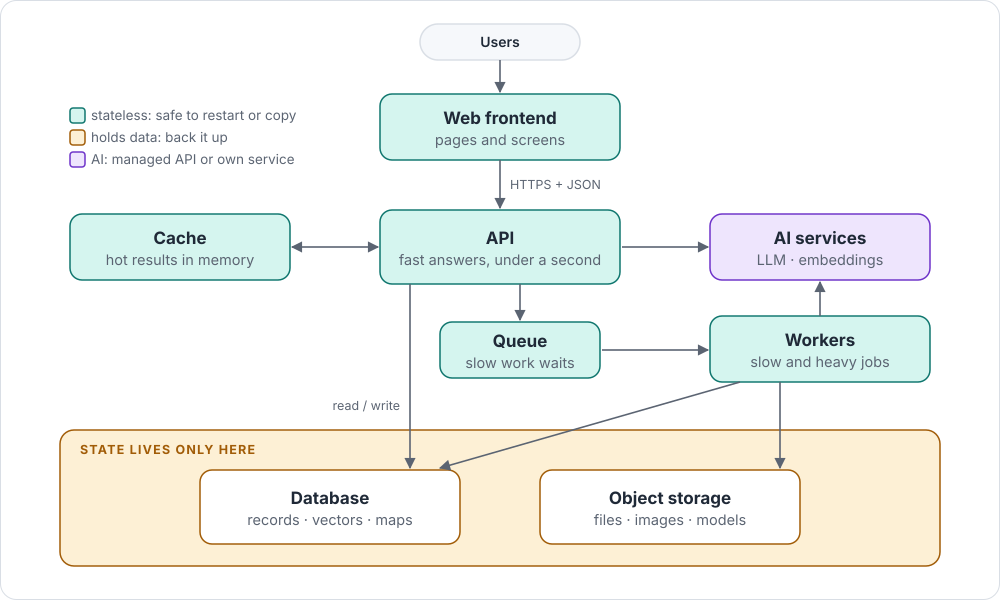

# App architecture

The seven parts of almost every web app, AI-powered or not, and how they connect.

## In one picture

## Remember

- **Users talk to the frontend; the frontend talks only to the API.**
- **Anything slower than about a second goes to the queue**, and workers do it.
- **Only the database and object storage hold data**, so everything else can restart or scale freely.
- **The cache is a shortcut, never the truth.** It can be emptied at any moment.
- **Heavy AI models get their own service**, so the API stays light and fast.

## Go deeper

- [Reference app architecture](../cards/reference-architecture.md): each layer, its job, provider names
- [Design the architecture](../guides/architecture.md): the step-by-step guide
- [Background jobs and queues](../cards/background-jobs.md) · [When to split a service?](../decisions/when-to-split.md) · [Model serving](../cards/model-serving.md)
