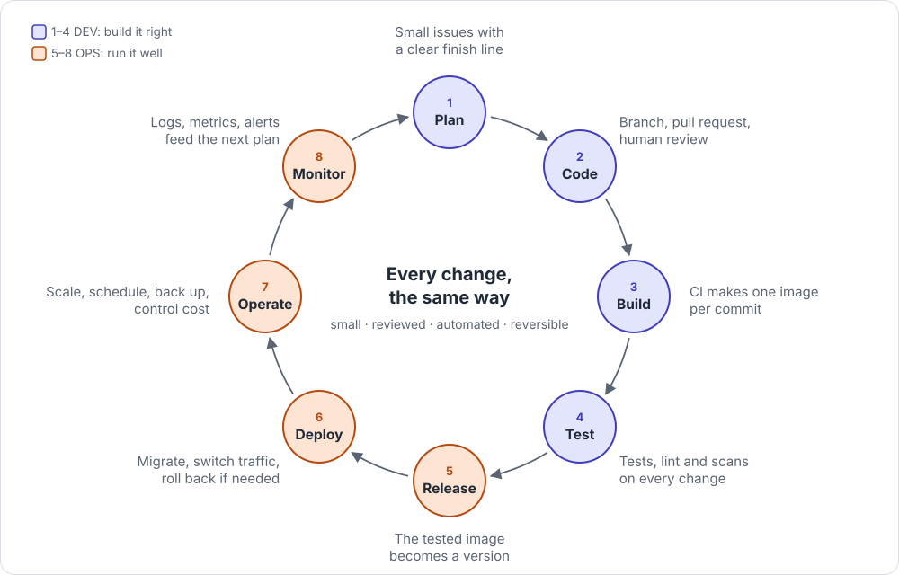

# The delivery loop

The eight steps every change takes, from idea to running in production and back.

## In one picture

## Remember

- **Steps 1–4 build it right:** a small issue, a reviewed pull request, one image, automatic tests.
- **Steps 5–8 run it well:** a versioned release, a safe deploy, scaling and backups, alerts.
- **Every change takes the same path.** No shortcuts straight to production.
- **Rollback takes minutes, not hours.** If a deploy goes wrong, switch back to the last good version.
- **Monitoring closes the loop:** what you see in production becomes the next plan.

## Go deeper

- Stage guides: [1 Plan](../guides/01-plan.md) · [2 Code](../guides/02-code.md) · [3 Build](../guides/03-build.md) · [4 Test](../guides/04-test.md) · [5 Release](../guides/05-release.md) · [6 Deploy](../guides/06-deploy.md) · [7 Operate](../guides/07-operate.md) · [8 Monitor](../guides/08-monitor.md)
- [Which CI/CD?](../decisions/which-ci.md) · [Production-ready checklist](../checklists/production-ready.md)
