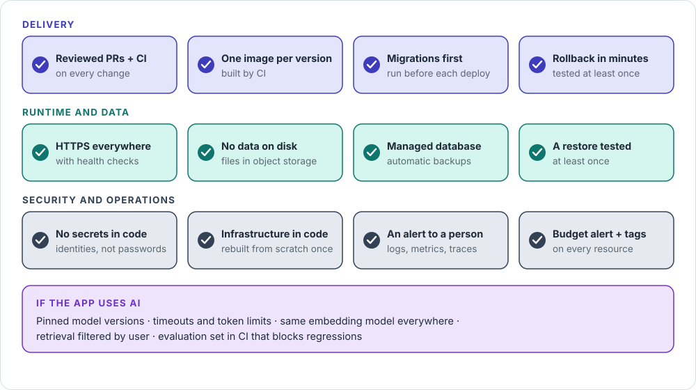

# Going live

The minimum checks before real users depend on your app, in twelve tiles.

## In one picture

## Remember

- **If you can't roll back in minutes, you're not ready.**
- **A backup counts only after you've restored it once.**
- **No secrets anywhere in code;** apps and CI use identities.
- **At least one alert must reach a person,** not just a dashboard.
- **AI features add five checks,** from pinned models to evaluation in CI.

## Go deeper

- [Production-ready checklist](../checklists/production-ready.md): every item, with links
- [6 Deploy](../guides/06-deploy.md) · [Security](../guides/security.md) · [8 Monitor](../guides/08-monitor.md)
